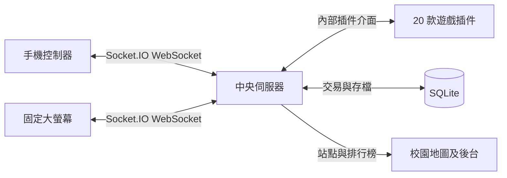

# 資料庫、通訊與插件

## 伺服器時鐘與遊戲同步

伺服器鑑別手機令牌、主機金鑰及管理金鑰。場次用 UUID，手機每次操作包含場次 ID、遞增的 `seq` 與一項 `action`。伺服器只接受該玩家同場的合法操作，並以伺服器收到操作的時間驗證截止。正式遊戲的 `deadline - startedAt` 固定為 60,000 毫秒。所有時間戳均為 Unix epoch 毫秒。

每一方有獨立的插件狀態，同方的玩家共享一個棋盤或題目進度。大螢幕接收各方的場景、進度和游標。手機接收玩家編號、陣營、答題編號及選項數。校園看板接收站點摘要。重連時恢復同一場次、截止時間及最新輸入序號。

史萊姆排球在 1 對 1 或 2 對 2 中共用一座球場，手機以 `hold-left`、`hold-right`、`release` 及 `jump` 控制各自的角色。大螢幕接收權威球場和比數，限時結束比較球場得分，再沿用正式勝負計分。

## Socket.IO

Socket 路徑是 `/socket.io`，傳輸為 WebSocket。事件定義及 Zod 輸入驗證位於 [protocol.ts](../packages/shared/protocol.ts)。

| 方向 | 事件 | 功能 |
| --- | --- | --- |
| 客戶端 → 伺服器 | `campus:watch`、`clock:sync` | 訂閱校園狀態及對時 |
| 客戶端 → 伺服器 | `player:join`、`player:login`、`player:reconnect`、`player:leave` | 暱稱登記、學號登入、恢復身分、離開 |
| 客戶端 → 伺服器 | `team:join` | 請求更換隊伍 |
| 客戶端 → 伺服器 | `match:find`、`match:assist`、`match:cancel` | 尋找對手、報名陪打、退出配對或候場 |
| 客戶端 → 伺服器 | `station:scan`、`station:join`、`station:leave` | 驗證房間入場碼、入場或排隊、離開站點 |
| 客戶端 → 伺服器 | `game:ready`、`game:input` | 就緒狀態、移動、點格、動作或送出答案 |
| 客戶端 → 伺服器 | `host:register`、`admin:watch` | 登記固定主機、訂閱授權後台資訊 |
| 伺服器 → 客戶端 | `campus:state`、`station:update`、`host:status` | 站點、地圖、主機與房況 |
| 伺服器 → 大螢幕 | `host:entry` | 本站更新後的入場網址和截止時間 |
| 伺服器 → 客戶端 | `player:update`、`player:kicked`、`team:update`、`team:status` | 玩家、隊伍與參賽者狀態 |
| 伺服器 → 客戶端 | `game:start`、`game:state`、`game:progress` | 倒數時間、可視畫面、任務進度 |
| 伺服器 → 客戶端 | `game:double-challenge` | 向同一場的手機及大螢幕公布抽中的玩家 |
| 伺服器 → 客戶端 | `game:finish`、`game:timeout` | 提前結束、作廢或 60 秒截止 |
| 伺服器 → 客戶端 | `score:result`、`score:team-average`、`score:leaderboard` | 個人結果、多人原始總分和平均、雙排行榜 |
| 伺服器 → 客戶端 | `admin:status`、`system:error` | 後台監控和錯誤回報 |

客戶端請求回覆為 `{ ok: true, data }` 或 `{ ok: false, code, error }`。正式結算事件由伺服器傳送。`game:input` 接受角色移動 `move`、游標 `cursor`、動作 `action`、選項 `choice`、文字答案 `answer`。伺服器比對當前題目 ID、玩家陣營及場次。管理 API 的路由與權限位於 [service.ts](../apps/server/src/service.ts)。

`player:login` 接收 `studentNumber` 和 `code`。登入成功後簽發新的手機令牌，原裝置會退出。學號和登入碼雜湊由伺服器管理，公開事件及公開排行榜只提供玩家名稱。`campus:state.selfRegistration` 指示手機是否提供暱稱登記。

答題經伺服器接受後，該玩家須等候 2,000 毫秒才能再送出答案。正式賽的 `match.remote` 和練習房的 `remote` 傳回個人的 `answerAvailableAt`。提早送出目前題目的答案會收到 `answer-cooldown`。同方其他手機各自計時。

大螢幕斷線時傳回 `pausedAt`，手機以該時間凍結場次倒數。重連成功便推移遊戲截止時間及答題等候時間。連續斷線達 30 秒會取消場次，正式賽已報到的玩家可重新配對。

`station:scan` 依伺服器時間驗證房間、大螢幕目前的連線及 10 秒有效期。驗證成功後，該手機連線有最多 90 秒使用該入場資格，受本場報到時限約束。每位玩家掃描配對房間的 QR Code 後可標記準備。至少兩人報到並就緒才可倒數。

`player:update` 的 `route` 傳送完成關數、配對狀態和下一站。大螢幕收到 `match.panels`，手機收到 `match.remote`。相同種子讓各方的初始盤面或題組一致，手機輸入只影響該玩家的陣營。

陪打由 `match:assist` 報名。陪打參賽者的 `assisting` 為真，結算記錄保留勝負及操作資料，計入分為 0。正式賽同方答題紀錄的 `metrics.attempted` 與 `metrics.correct` 代表個人，`metrics.sideAnswers` 代表該方合計。

排球站點的大螢幕須提供介面版本 `screenVersion: 3`。其他站點也接受 `screenVersion: 2`。舊版排球站點重新整理後會沿用瀏覽器內原有的專屬金鑰。

## SQLite

[完整遷移](../apps/server/src/migrations.ts) 由 `PRAGMA user_version` 依序以交易執行。資料庫啟用外鍵、WAL 與約束。

| 資料表 | 用途 |
| --- | --- |
| `players`、`teams` | 玩家 ID、唯一學號、登入碼及令牌雜湊、停用狀態、隊伍與個人累計。每隊最多 5 位 |
| `games`、`hosts`、`campus_stations` | 遊戲和插件設定、固定螢幕、站點與地圖座標 |
| `competitions`、`competition_rosters`、`game_rounds` | 活動屆數、重置原因、封存名單及舊制正式輪次 |
| `match_search`、`player_routes` | 當前配對隊列及舊制個人路線 |
| `game_sessions`、`session_members` | 場次時鐘、各方遊戲狀態、報到、陣營、關次及重連狀態 |
| `game_results`、`team_results` | 個人出席、勝負、基礎分、計入分、耗時及任務統計，以及舊制多人場記錄 |
| `official_results` | 每人、每關、每屆唯一一筆目前計入的成績 |
| `audit_log`、`settings` | 後台操作記錄及上傳地圖 |
| `floor_maps` | 三樓與四樓各自的地圖更換紀錄 |

`game_results` 的 `(session_id, player_id)` 唯一。同屆、同玩家、同關次的有效正式成績也具唯一約束。場次狀態轉移、結果寫入及排行榜來源更新在同一個 SQLite 交易內完成。管理員使用 `POST /api/admin/sessions/:id/void` 連同撤銷原因，交易內標記原始紀錄、重算受影響玩家的成績及寫入稽核。SQLite 依關次導出難度權重和計入分。

遷移第 3 版將站點配對到三樓與四樓，第 4 版換算重繪圖座標，第 5 版加入個人路線與計分權重，第 6 版保存對戰配對、陣營及每位玩家的計分難度。第 7 版保存大螢幕暫停時鐘、陪打、和局及撤銷時間，舊版 2 對 2 的答題合計標為本方紀錄。結果的 `baseAwarded` 為依難度計算的基礎分，`awarded` 包括雙倍調整。

第 8 版加入學生帳號、暱稱登記設定及屆別名單封存。重置時在同一交易中保存本屆的玩家名稱、隊伍及重置原因，並啟用下一屆。歷史榜從該屆的正式結算紀錄讀取。

第 9 版將數字推理的站點改為史萊姆排球。原有結果按數字推理記錄，未結算的數字推理場次會取消，已報到的參賽者返回配對。

## 註冊插件

1. 建立新的 `local-games/game-XX/index.ts`，以 `plugin<State>()` 接入 [SDK](../packages/game-sdk/index.ts)。
2. 定義 `init`、`handleInput`、`getState`、`getProgress` 與 `checkWin`。由 `init` 接收每人的 `seed` 和 `tier`，產生可重現的難度及配置。可加 `start`、`tick`、`isComplete`、`finish` 和 `destroy`。
3. 將工廠登錄至 [registry.ts](../local-games/registry.ts)，把顯示資料加入 [catalog.ts](../packages/shared/catalog.ts)。現有格子、試管、答題及動態場景可沿用。新場景可擴充 `Scene` 和共用 `SceneView`。
4. 目前有 20 個遊戲房間，每人完成 10 款不同遊戲。場次為每一方建立一份插件，每方的手機操作共用該狀態。

