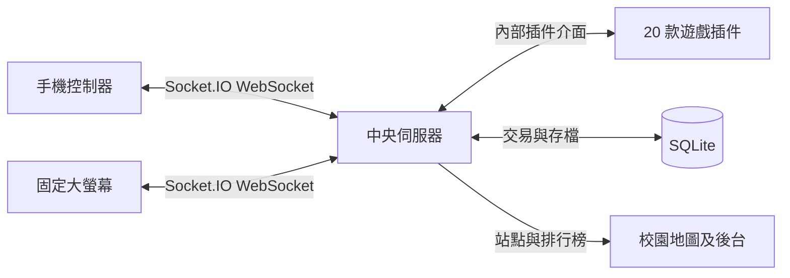

# 資料庫、通訊與插件

## 伺服器時鐘與遊戲同步

伺服器鑑別手機令牌、主機金鑰及管理金鑰。場次用 UUID，手機每次操作包含場次 ID、遞增的 `seq` 與一項 `action`。伺服器只接受該玩家同場的合法操作，並以伺服器收到操作的時間驗證截止。正式遊戲的 `deadline - startedAt` 固定為 60,000 毫秒。所有時間戳均為 Unix epoch 毫秒。

一間房的操作只送進該房的插件狀態。手機收到自己的題目及遊戲版面，大螢幕收到參賽者、倒數、進度和結算，校園看板收到站點摘要。手機重連會收到同一場次及最新輸入序號。重啟會恢復場次狀態和截止時間，離線期間依伺服器的實際時鐘推進。

## Socket.IO

Socket 路徑是 `/socket.io`，傳輸為 WebSocket。事件定義及 Zod 輸入驗證位於 [protocol.ts](../packages/shared/protocol.ts)。

| 方向 | 事件 | 功能 |
| --- | --- | --- |
| 客戶端 → 伺服器 | `campus:watch`、`clock:sync` | 訂閱校園狀態及對時 |
| 客戶端 → 伺服器 | `player:join`、`player:reconnect`、`player:leave` | 登記、恢復身分、離開 |
| 客戶端 → 伺服器 | `team:join` | 請求更換隊伍 |
| 客戶端 → 伺服器 | `station:scan`、`station:join`、`station:leave` | 驗證房間入場碼、入場或排隊、離開站點 |
| 客戶端 → 伺服器 | `game:ready`、`game:input` | 就緒狀態、移動、點格、動作或送出答案 |
| 客戶端 → 伺服器 | `host:register`、`admin:watch` | 登記固定主機、訂閱授權後台資訊 |
| 伺服器 → 客戶端 | `campus:state`、`station:update`、`host:status` | 站點、地圖、主機與房況 |
| 伺服器 → 大螢幕 | `host:entry` | 本站更新後的入場網址和截止時間 |
| 伺服器 → 客戶端 | `player:update`、`player:kicked`、`team:update`、`team:status` | 玩家、隊伍與參賽者狀態 |
| 伺服器 → 客戶端 | `game:start`、`game:state`、`game:progress` | 倒數時間、可視畫面、任務進度 |
| 伺服器 → 客戶端 | `game:double-challenge` | 向同一場的手機及大螢幕公布抽中的玩家 |
| 伺服器 → 客戶端 | `game:finish`、`game:timeout` | 提前結束、作廢或 60 秒截止 |
| 伺服器 → 客戶端 | `score:result`、`score:team-average`、`score:leaderboard` | 個人結果、多人原始總分和平均、雙排行榜 |
| 伺服器 → 客戶端 | `admin:status`、`system:error` | 後台監控和錯誤回報 |

客戶端請求回覆為 `{ ok: true, data }` 或 `{ ok: false, code, error }`。正式結算事件由伺服器傳送。`game:input` 的可用操作是 `move`、`cell`、`action` 與 `answer`。答案必須帶目前的題目 ID。管理 API 使用 `Authorization: Bearer <ADMIN_KEY>`，路由集中於 [service.ts](../apps/server/src/service.ts)。

`station:scan` 依伺服器時間驗證房間、大螢幕目前的連線及 10 秒有效期。驗證成功後，該手機連線有 90 秒完成登記並取得一次本站入場資格。建立房間或加入隊列後即消耗資格，正在候場、排隊或遊玩中的重連會沿用同一場次。

`player:update` 的 `route` 傳送完成關數和下一站。已登記的玩家需到指定房間才可掃碼進場。先掃碼後登記時，伺服器在正式入場前才比對玩家的下一站。個人任務配置、後續順序和正確答案保存在伺服器端。

## SQLite

[完整遷移](../apps/server/src/migrations.ts) 由 `PRAGMA user_version` 依序以交易執行。資料庫啟用外鍵、WAL 與約束。

| 資料表 | 用途 |
| --- | --- |
| `players`、`teams` | 玩家 ID、連線、雜湊令牌、隊伍與個人累計。每隊最多 5 位 |
| `games`、`hosts`、`campus_stations` | 遊戲和插件設定、固定螢幕、站點與地圖座標 |
| `competitions`、`game_rounds` | 活動屆數及舊制正式輪次 |
| `player_routes` | 每屆每位玩家的 20 個關次、對應遊戲、任務種子及雙倍抽籤 |
| `game_sessions`、`session_members`、`station_queue` | 場次時鐘、報到及重連狀態、排隊資料 |
| `game_results`、`team_results` | 個人出席、勝負、基礎分、計入分、耗時及任務統計，以及舊制多人場記錄 |
| `official_results` | 每人、每關、每屆唯一一筆目前計入的成績 |
| `audit_log`、`settings` | 後台操作記錄及上傳地圖 |
| `floor_maps` | 三樓與四樓各自的地圖更換紀錄 |

`game_results` 的 `(session_id, player_id)` 唯一。現制的同屆、同玩家、同關次出席結果也具唯一約束。場次狀態轉移、結果寫入及排行榜來源更新在同一個 SQLite 交易內完成。SQLite 依關次導出難度權重和計入分。

遷移第 3 版將站點配對到三樓與四樓，第 4 版換算重繪圖座標，第 5 版加入個人路線與計分權重。如果舊制活動已有場次，升級時會封存舊屆，原玩家進入新一屆。客戶端在抽籤揭曉後收到 `doubleChallenge`。結果的 `baseAwarded` 為依難度計算的基礎分，`awarded` 為包含雙倍調整的計入分。

## 註冊插件

1. 建立新的 `local-games/game-XX/index.ts`，以 `plugin<State>()` 接入 [SDK](../packages/game-sdk/index.ts)。
2. 定義 `init`、`handleInput`、`getState`、`getProgress` 與 `checkWin`。由 `init` 接收每人的 `seed` 和 `tier`，產生可重現的難度及配置。可加 `start`、`tick`、`isComplete`、`finish` 和 `destroy`。
3. 將工廠登錄至 [registry.ts](../local-games/registry.ts)，把顯示資料加入 [catalog.ts](../packages/shared/catalog.ts)。現有格子、試管、答題及動態場景可沿用。新場景可擴充 `Scene` 和共用 `SceneView`。
4. 目前正式賽維持 20 關。擴大正式賽計分名額時，要同步調整資料庫約束。插件傳回的進度、答對題數及任務旗標由中央伺服器決定勝負。

